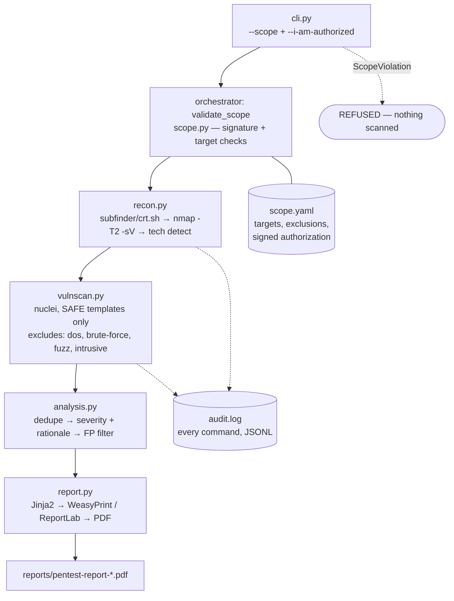

# Blueprint

Automated vulnerability assessments that produce a **professional pentest report (PDF)**
for small businesses — the engine behind a future subscription SaaS
(monthly/quarterly scans for businesses that can't afford a $15k pentest).

Built as a portfolio project: clean code, real safety engineering, and a report
you can show a hiring manager.

> **Authorized scanning only.** The agent refuses to run without a signed scope
> file **and** the `--i-am-authorized` flag, and it will never touch a target
> outside that scope. Scanning without permission is illegal — this tool is
> built to make doing the right thing the default.

## Architecture



Every phase calls `assert_in_scope()` before touching a target. Missing scanner
binaries degrade gracefully (step skipped with a warning, never a crash).

## Quickstart

```bash
./setup.sh                  # .venv + python deps + scanner binary check
source .venv/bin/activate

# 1) Local lab demo (needs Docker): Juice Shop + DVWA, pre-authorized scope
./scripts/run_lab_pipeline.sh

# 2) Real engagement: copy the example scope, fill it in, get it signed
cp scope.yaml.example scope.acme-2026-09.yaml
# ... edit targets + authorization block ...
python -m pentest_agent.cli --scope scope.acme-2026-09.yaml --i-am-authorized

# 3) Run the test suite
pytest -q
```

A sample report from a real pipeline run is committed at
[`reports/sample-pentest-report-lab-2026-09-25.pdf`](reports/sample-pentest-report-lab-2026-09-25.pdf)
— open it to see the output format before you run your own scan.

Reports land in `reports/` as timestamped PDF (HTML fallback if no PDF
backend is installed). Intermediate artifacts (recon JSON, nuclei JSONL,
`audit.log`) go to `.work/`.

## Project layout

| Path | What it does |
|---|---|
| `pentest_agent/cli.py` | Argument parsing, two-key authorization gate |
| `pentest_agent/scope.py` | Scope loading, signature check, in-scope enforcement |
| `pentest_agent/audit.py` | Append-only JSONL log of every executed command |
| `pentest_agent/recon.py` | Subdomain enum, nmap scan, tech detection |
| `pentest_agent/vulnscan.py` | nuclei with the safe-template policy |
| `pentest_agent/analysis.py` | Dedupe, severity + rationale, FP filtering |
| `pentest_agent/report.py` | Jinja2 HTML → PDF (WeasyPrint, ReportLab fallback) |
| `pentest_agent/orchestrator.py` | Pipeline; LangGraph if installed, sequential otherwise |
| `pentest_agent/templates/report.html` | Professional report template |
| `scope.yaml.example` / `scope.lab.yaml` | Engagement scope files |
| `docker-compose.yml` | Lab targets (Juice Shop, DVWA) |
| `scripts/run_lab_pipeline.sh` | End-to-end lab verification |
| `tests/` | pytest suite (scope, analysis, report) |

## Safety design (worth talking about in interviews)

- **Two-key authorization**: `--i-am-authorized` flag **and** a signed scope file.
  Either missing → the pipeline refuses before any packet is sent.
- **Scope is a hard gate**: `assert_in_scope()` runs per target *and* per port;
  exclusions override CIDR matches.
- **Non-destructive by construction**: nuclei excludes `dos, brute-force, fuzz,
  intrusive` tags and is rate-limited; there are no exploit modules in the MVP.
- **Audit trail**: every command (with return code and timing) is appended to
  `audit.log` and summarized in the report appendix.
- **Filtered findings are listed**, with reasons — nothing disappears silently.

## Current status

- ✅ Scope enforcement, audit logging, recon, safe vuln scanning, analysis, PDF reports
- ✅ Lab compose file + end-to-end verification script
- ✅ LangGraph orchestration active; sequential mode is the automatic fallback if LangGraph is ever missing
- ✅ Sample lab report committed: `reports/sample-pentest-report-lab-2026-09-25.pdf` (full pipeline run against local lab targets; recon detected the targets, nuclei phase skipped because the scanner binary isn't installed here)
- ⚠️ The full Juice Shop + DVWA lab targets need Docker — run `scripts/run_lab_pipeline.sh` on a Docker host for the complete scan with real vulnerabilities
- 🗺️ SaaS wrapper (dashboard, Stripe, scheduling) → see [ROADMAP.md](ROADMAP.md)
